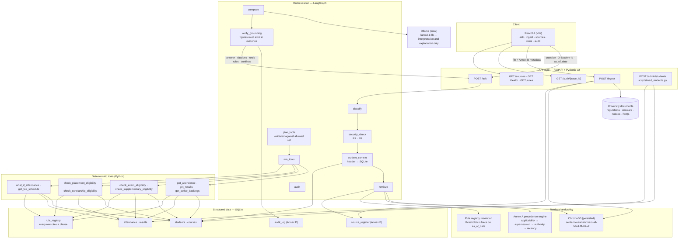

# AI-Powered University Student Services Assistant

Use Case 2 of the HCLTech Future Ready AI Engineer Hackathon. A grounded, cited
assistant that answers university academic-service questions from authorised
documents and decides eligibility from authorised student records using
deterministic tools.

Every factual answer carries the document, clause, version and effective date it
came from. Nothing authoritative is produced by a language model: thresholds come
from the rule registry, calculations and eligibility come from tools over SQLite,
and conflicting or versioned documents are resolved by the Source Precedence
Policy in Annex A of the participant guide.

---

## 1. What it does

| Question type | Example | How it is answered |
| --- | --- | --- |
| Policy fact | "What is the minimum attendance required to appear for the end-semester examination?" | Retrieval + precedence: the circular in force supersedes the regulation clause; both are cited |
| Procedure | "How do I apply for the supplementary examination?" | Cited steps from the examination rules |
| Personal data | "What is my attendance in CS201?" | Tool over SQLite, computed percentage, never stored |
| Personal eligibility | "Am I eligible for the supplementary examination in EC201?" | Tool comparing the student's record against the registry threshold |
| Multi-step / what-if | "I failed CS201. If I pass the supplementary, will I be eligible for placement?" | Several tools and clauses, with the assumptions stated |
| Not answerable | "What is the scholarship for studying in Antarctica?" | `answer_type: not_found` with the required message |

## 2. Quick start

Everything runs with two local processes: a FastAPI service and the Vite dev
server. There is no container step.

```bash
python -m venv .venv && . .venv/Scripts/activate      # Linux/macOS: source .venv/bin/activate
pip install -r requirements.txt

python scripts/init_db.py                             # schema, rule registry, register, students
python scripts/ingest_documents.py                    # chunk + embed the corpus into ChromaDB

# terminal 1 - API
cp .env.example .env
uvicorn assa.api:app --reload --port 8000 --env-file .env

# terminal 2 - React UI (proxies /api to the API)
cd ui && npm install && npm run dev                   # http://localhost:5173
```

* React UI: <http://localhost:5173>
* API and Swagger UI: <http://localhost:8000/docs>

The API ingests every document in the Source Register on first start, so the
index is ready in a couple of minutes (the embedding model downloads once and is
cached in `./data/hf-cache`). ChromaDB and SQLite persist under `./data`.

### Serving the built UI (optional)

```bash
cd ui && npm run build                 # static files in ui/dist
```

A built UI still has to reach the API. Either build with an explicit origin
(`VITE_API_BASE=http://localhost:8000 npm run build`) and serve `ui/dist` from
any static server, or keep `/api` on the same origin by rewriting that prefix to
the API in whatever server you use. The dev server already does this for you.

Everything runs with `MOCK_LLM=true`: classification, tool selection, retrieval,
precedence, composition and the grounding checks all have deterministic paths, so
the system is demonstrable without a model. Set `MOCK_LLM=false` to use Ollama.

## 3. Architecture



Key decisions, and why:

* **One fixed workflow, not a swarm.** The steps are known and ordered, so a
  LangGraph state machine with one node per step is simpler to test and explain
  than specialist agents. The model influences three cheap things (question
  category, which of the *already-allowed* tools to call, the wording of the
  explanation) and nothing authoritative.
* **Precedence is code, not a prompt.** Annex A is a deterministic algorithm over
  document metadata; running it in the prompt would make the same question answer
  differently on different days.
* **Thresholds live in the registry.** No policy number appears in Python. A new
  circular adds a row that names the clause it comes from and the row it
  supersedes, and the tools follow.
* **Grounding is enforced, not requested.** Every figure in a final answer must
  exist in the retrieved clauses or in a tool result. A model-written explanation
  that introduces a number is discarded and the deterministic text is used.

## 4. API

The contract in Section 6 of the participant guide is implemented exactly.

```bash
# Ask a general policy question (no identity needed)
curl -s localhost:8000/ask -H 'Content-Type: application/json' \
  -d '{"question":"What is the minimum attendance required to appear for the end-semester examination?"}' | jq

# Ask about your own record: identity comes from the header, never the text
curl -s localhost:8000/ask -H 'Content-Type: application/json' -H 'X-Student-Id: S2002' \
  -d '{"question":"Am I eligible to appear for the end-semester examination in CS201?","as_of_date":"2026-10-06"}' | jq

# Ingest a document while the system is running
curl -s localhost:8000/ingest \
  -F 'file=@documents/ACAD-2026-08_minimum_attendance_circular.md' \
  -F 'metadata={"doc_id":"JUDGE-01","title":"Judge circular","issuer":"Registrar","authority_level":2,"doc_type":"circular","version":"1.0","effective_from":"2026-10-01","supersedes":"ACAD-2026-08#1.1","scope_programmes":"ALL","scope_batches":"ALL","provenance":"judging","synthetic":"N"}' | jq

# Readiness, audit record and the Source Register
curl -s localhost:8000/health | jq
curl -s localhost:8000/audit/7f3c2a9e | jq
curl -s localhost:8000/sources | jq '.[] | {doc_id, authority_level, effective_from, chunks_indexed}'
```

Response shape (`POST /ask`), with the field names fixed by the guide:

```json
{
  "trace_id": "7f3c2a9e",
  "answer": "You are eligible to appear in the end-semester exam for CS201.",
  "answer_type": "calculated",
  "citations": [{"doc_id": "ACAD-2026-08", "title": "Circular ACAD-2026-08 ...", "section": "1.1",
                 "page": 1, "version": "1.0", "effective_from": "2026-08-01"}],
  "tools_invoked": [{"tool": "check_exam_eligibility", "input": {"course_code": "CS201"},
                     "output": {"result": "ELIGIBLE", "rule_id": "ATT-MIN-02"}, "status": "ok", "ms": 2}],
  "applied_rules": [{"rule_id": "ATT-MIN-02", "parameter": "min_attendance_pct", "value": ">= 80",
                     "source_doc_id": "ACAD-2026-08", "source_section": "1.1",
                     "effective_from": "2026-08-01"}],
  "conflicts_detected": [],
  "explanation": "Your attendance in CS201 is 80.0%, at the 80% minimum in clause 1.1 ...",
  "as_of_date": "2026-10-06"
}
```

`answer_type` is one of `retrieved_fact`, `calculated`, `not_found`,
`clarification_needed`, `refused`, `conflict_flagged`.

## 5. Data

### Documents (`documents/`, register in `data/source_register.csv`)

Eleven documents covering two programmes, two batches and all five authority
levels, including a superseding circular, a not-yet-effective circular, a
department notice, a help-desk FAQ that contradicts the circular, an unofficial
student-council notice, and a document carrying an embedded instruction.

> **Replace these with your own university's public documents before judging.**
> They were written for this repository to demonstrate the pipeline and are marked
> `synthetic=Y` in the Source Register on purpose. Keep at least three real
> documents (the guide's minimum) and register each one. The pipeline,
> precedence policy, rule registry and evaluation set are document-agnostic: drop
> the files in `documents/`, register them, and re-run `scripts/ingest_documents.py`.
> Do not use any document that contains real personal data.

### Synthetic student data (`data/*.csv`, generated, never real)

| File | Rows | Schema |
| --- | --- | --- |
| `students.csv` | 30+ | Annex C `students` |
| `courses.csv` | 6 | Annex C `courses` |
| `attendance.csv` | 100+ | Annex C `attendance` |
| `results.csv` | 90+ | Annex C `results` |

The generator (`scripts/generate_students.py`), the verbatim prompt
(`prompts/generate_students.md`), the validator (`scripts/validate_students.py`),
the judge-facing loader (`scripts/load_students.py`), the raw model replies and
the repair log are all in the repository; see `data/DATA_CARD.md` (Annex E) for the
generation record, the errors the model made and the edge cases carried by
specific student IDs.

```bash
python scripts/generate_students.py --source deterministic   # same schema, seeded, no model
python scripts/generate_students.py --source llm             # call Ollama with the committed prompt
python scripts/validate_students.py                          # exits non-zero on any violation

python scripts/load_students.py --dir test_students/         # judges' loader (CLI)
curl -F students=@students.csv -F courses=@courses.csv \
     -F attendance=@attendance.csv -F results=@results.csv \
     localhost:8000/admin/students                            # the same loader over HTTP
```

Student IDs `S9000`-`S9999` and course codes starting with `JDG` are reserved for
the judges and never appear in our data.

## 6. Rule registry: how a threshold changes

Every tool reads its thresholds from `rule_registry`, and every row cites the
clause it came from (`source_doc_id`, `source_section`) plus the row it replaces
(`supersedes_rule_id`). To follow a new circular:

```bash
# 1. ingest the circular (via POST /ingest or the documents/ directory)
# 2. register the new threshold and the row it replaces
python scripts/add_rule.py --rule-id ATT-MIN-03 --parameter min_attendance_pct \
  --operator '>=' --value 85 --description "Minimum attendance after circular ACAD-2026-12" \
  --source-doc-id ACAD-2026-12 --source-section 1.1 --effective-from 2026-12-01 \
  --supersedes ATT-MIN-02
```

`add_rule.py` refuses to add a rule whose source document is not in the Source
Register, because an uncited threshold is exactly what R5 forbids. After the
change, `check_exam_eligibility` uses 85% for dates on or after 2026-12-01 and 80%
before it, with no code change (`tests/test_tools.py::test_thresholds_come_from_the_registry_not_from_code`
proves it).

## 7. Source Precedence Policy (Annex A) as implemented

`src/assa/precedence.py`, in the policy's own order:

1. **Applicability** — only documents effective on `as_of_date` whose programme
   and batch scope cover the student (or are general). A document that is not yet
   effective is excluded from the answer and reported as an upcoming change.
2. **Explicit supersession** — a document that names another document or clause
   replaces it, if the superseding document is authority level 1 or 2.
3. **Authority** — higher authority prevails regardless of date; unofficial
   (level 5) content can never override anything.
4. **Recency** — between equals, the later `effective_from` prevails.
5. **Unresolved** — both documents are cited, `answer_type` becomes
   `conflict_flagged`, and the answer advises contacting the issuing office.

The worked example from the guide is a unit test
(`tests/test_precedence.py::test_worked_example_resolves_to_the_circular`): the
regulation says 75%, the circular supersedes the clause with 80%, the FAQ says
65% — the answer is 80%, and the FAQ is reported as unable to override it.

## 8. Evaluation

```bash
python scripts/run_evaluation.py                # default configuration
python scripts/run_evaluation.py --compare      # default vs top-k 8 vs a lower relevance floor
python scripts/run_evaluation.py --mock         # no model calls
```

28 questions in `evaluation/eval_set.jsonl`, including the buckets the guide
requires: unanswerable, version/conflict, personal (tool-answered), attempts to
read another student's data, multi-step, plus a live-ingestion case that ingests a
previously unseen circular *during* the run — one that supersedes a clause and
carries an embedded instruction.

Reported metrics: answer correctness, citation accuracy, abstention accuracy,
tool-result correctness, retrieval hit rate, conflict handling, latency p50/p95,
LLM calls and tokens per question, broken down by bucket. Method: exact match on
numbers and dates plus a recorded rubric check that the expected clause was cited.
Measured results are in `evaluation/report.json`, `evaluation/comparison.md` and
`evaluation/REPORT.md`; the UI shows them under **Health & evaluation**. No number
in those files is a target — each one was produced by running the harness in this
repository.

## 9. Configuration

All settings are environment variables with defaults; see `.env.example`. Notable
ones: `OLLAMA_HOST`, `ASSA_OLLAMA_MODEL`, `MOCK_LLM`, `ASSA_EMBEDDING_MODEL`,
`ASSA_TOP_K`, `ASSA_MIN_SCORE` (relevance floor), `ASSA_CLOUD_FALLBACK`
(disabled by default).

## 10. Tests

```bash
pytest -q              # 90+ tests: precedence, tools, guardrails, chunking,
                       # data validation, the API contract, the fixed schema
                       # and the end-to-end workflow
```

The suite runs with `MOCK_LLM=true` and a deterministic test embedder, so it needs
no model and no download (`tests/conftest.py`). Retrieval *quality* is measured by
the evaluation harness instead, with the real embedding model.

## 11. Repository layout

```
src/assa/
  api.py           FastAPI contract (Section 6)
  graph.py         LangGraph workflow, audit writing
  reasoning.py     classification, tool planning, composition, grounding checks
  retrieval.py     vector search + Source Register metadata + precedence
  precedence.py    Annex A policy and rule-registry resolution
  tools.py         deterministic tools (no thresholds in code)
  rules.py         rule registry access
  guardrails.py    identity, injection, untrusted content, PII masking
  vectorstore.py   ChromaDB persistence + ingestion (R11)
  chunking.py      clause-aware chunking, page tracking, OCR detection
  embeddings.py    sentence-transformers (deterministic test embedder for tests)
  llm.py           Ollama client, MOCK_LLM, disclosed cloud fallback
  schemas.py       Pydantic v2 contract models
  db.py            Annex C schema, Source Register, audit log
  data_validation.py  schema and logical validation of the synthetic data

documents/   the corpus          data/        CSVs, database, index, data card
prompts/     verbatim prompt     evaluation/  eval set, harness, reports
scripts/     generation, validation, loading, ingestion, evaluation, rules
tests/       the suite           ui/          React (Vite) front end
```

## 12. Assumptions

* The student's identity is only ever the `X-Student-Id` header, validated against
  the `students` table. A `student_id` in the request body is ignored.
* Attendance percentages are always computed from `classes_attended / classes_held`
  and never stored (Annex C).
* A pass requires 40/100 **and** at least 30% of the paper marks
  (EXAM-RULES-2025 clauses 3.2 and 3.3), taken from the registry.
* The `results` table holds one row per attempt, so a cleared supplementary
  attempt removes the backlog (earlier `REGULAR` failure stays visible in the audit).
* A general question (no student) is answered from the whole corpus; scoped
  documents are kept and marked as scoped rather than silently dropped.
* The corpus in `documents/` stands in for the team's real university documents
  and is marked synthetic in the register.

## 13. Limitations

* **Inherited from the task**: this is a single-institution prototype with no
  authentication server; the header identity is a stand-in for a signed-in session.
* **Data**: the synthetic corpus is small (11 documents, ~150 clauses) and the
  student data is generated. Retrieval quality on a large real corpus has not been
  measured.
* **Model**: a local 7-8B model is used only for classification, constrained tool
  selection and explanation wording. With `MOCK_LLM=true` those three steps use the
  deterministic paths, which is why the evaluation reports both configurations.
* **OCR**: scanned pages need the optional extras (`requirements-ocr.txt`) plus
  Tesseract; without them a scanned PDF is reported as `needs_ocr`, never indexed
  with empty text.
* **Conflict detection at clause level** compares numeric claims for a known
  parameter plus explicit supersession links. A conflict expressed only in prose,
  with no number and no supersession metadata, is reported as an unresolved
  conflict rather than resolved.
* **Scanned or unusual layouts**: tables are read as text; a clause split across a
  page break keeps its page of origin.

## 14. Known edge cases handled

Attendance exactly at the threshold (eligible) and one class below (condonation
path), below the detention floor (detained), marks one mark below the pass mark
(FAIL, supplementary path), `ABSENT` results, multiple backlogs, CGPA exactly at
the placement cut-off, a course cleared through a supplementary attempt, a
question naming a course the student does not take, an unknown student identity, a
personal question with no identity, a request for another student's record, a
question with no course named (clarification), an instruction embedded in a
document, a document that is not yet effective, a rule that changes while the
system runs, and a document ingested mid-session that supersedes a clause already
indexed.

## 15. AI usage disclosure

AI coding assistants were used to write and review this code. Every part of it is
understood and can be explained by the team; nothing was copied from another
project. The synthetic student data was produced by a local LLM with the verbatim
prompt committed in `prompts/generate_students.md`, then validated and repaired by
code, with every repair logged in `data/generation_log.json`. The extraction of
the participant guide's rules, the corpus documents and the eval set expectations
were reviewed by a human against the guide.

## 16. Team contribution statement and declaration

To be completed by the team before submission:

| Member | Components | Evidence |
| --- | --- | --- |
| _name_ | _e.g. retrieval + precedence engine_ | _commits_ |
| _name_ | _e.g. React UI + evaluation harness_ | _commits_ |
| _name_ | _e.g. tools + synthetic data kit_ | _commits_ |
| _name_ | _e.g. API + audit trail_ | _commits_ |

We declare that this work is our own, that no real student personal data was used
anywhere in the system, and that no code was shared with another team.

_Signatures:_
